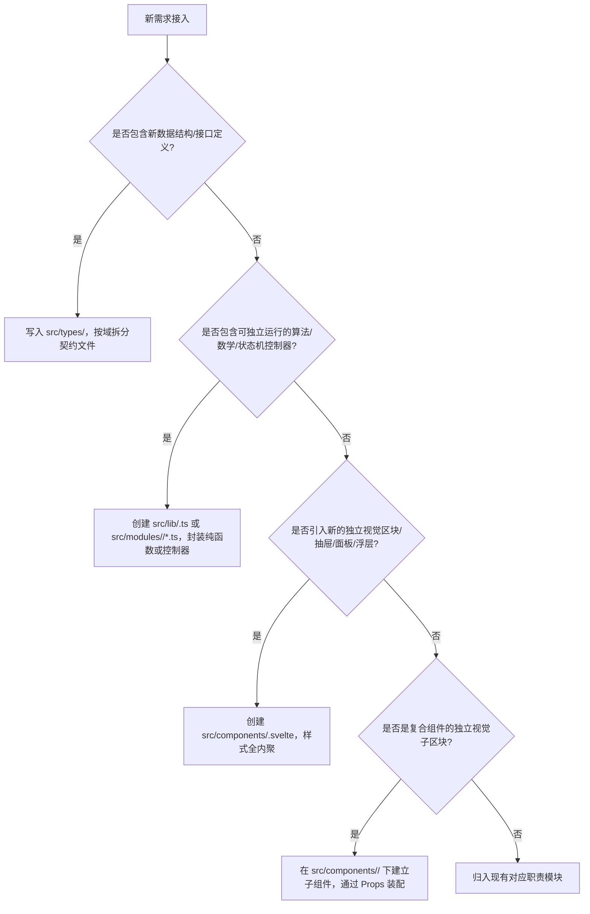

# Frontend Architecture Pattern & Formal Extension Rules

**Location**: `~/.gemini/Projects/Finnegan/kb/frontend_architecture_and_extensions.md`  
**Status**: Active / Production Standard  
**Governs**: `frontend/src/`  
**Related Specs**: [card_lifecycle_and_gravity.md](card_lifecycle_and_gravity.md), [aura_search_and_stage_repulsion.md](aura_search_and_stage_repulsion.md), [module_command_protocol.md](module_command_protocol.md)

---

## 1. 架构总纲：四层解耦单向流模型

Finnegan 前端采用严格的**四层分层治理与单向依赖模型**，彻底终结千行“上帝组件”的产生，确保无论业务如何膨胀，代码均可按明确的结构化边界生长：

```
[Layer 1: Type Domain]          src/types/card.ts
       │  (只定义契约，零外部依赖)
       ▼
[Layer 2: Pure Engines]         src/lib/*.ts
       │  (纯函数/数学物理计算，零 DOM 依赖)
       ▼
[Layer 3: Autonomous UI]        src/components/*.svelte
       │  (高内聚自治组件，专属样式，Props 入/Event 出)
       ▼
[Layer 4: Lean Orchestrator]    src/App.svelte
          (顶层装配器，只做状态持有、控制器装配与 IPC 事件桥接)
```

---

## 2. 四层职能规范与后端同包模块化规范

### 2.0 Go 后端 Wails 入口模块化规范 (`package main`)
为防止 `app.go` 沦为包揽一切的“上帝文件”，`main` 包下的 `*App` 方法必须严格按业务领域拆分到同包多文件中（对 Wails 前端绑定完全透明、零破坏）：
- **`app.go`**：仅保留 `App` 结构体定义、`NewApp()`、`startup()`、`shutdown()` 生命周期钩子与简洁的事件总线（Event Bus）订阅装配。
- **`app_events.go`**：承载 `startup()` 中挂载的事件总线与文件监听器（GlobalWatcher）具体回调实现（如 `onThoughtCapturedEvent`、`onWatcherFileChanged`、`onWatcherFileDeleted`），严禁在 `startup()` 内联百行匿名闭包。
- **`app_capture.go`**：承载灵感（Thought）、备忘（Note）的 Markdown 落盘、文件名 Slug 清洗（`sanitizeSlug`）以及图片二进制资源存储（`saveAssetImages`, `CaptureThought`, `CaptureThoughtWithImages`, `CaptureNote`）。纯标签/YAML 格式化逻辑下沉至 `core/keywords/`。
- **`app_chatlog.go`**：承载对话录（ChatLog）解析、LLM 主题提炼与多模态落盘（`ParseChatLog`, `DeriveChatLogTitle`, `ProcessChatLog`, `CaptureChatLog`, `CaptureChatLogWithImages`）。
- **`app_search_cmd.go`**：承载本地全卡片搜索（`SearchLocalCards`）、模块命令注册与执行（`GetRegisteredCommands`, `ExecuteModuleCommand`）、外部编辑器唤起（`OpenCardInEditor`, `ReloadCard`）、Bugu 雷达与临时卡片池绑定及 `WatcherStorage` 适配器。

### Layer 1: 纯类型契约层 (`src/types/`)
- **定位**：全前端唯一单点真相源（SSOT）。
- **约束**：只能包含 TypeScript `interface` 与 `type` 定义；**严禁包含任何运行时可执行逻辑**。
- **核心契约**：
  - `CosmicCard`：三维空间坐标 ($x, y, z, \text{rotation}$)、生命周期时间戳 (`spawnTime`, `decayDuration`, `macroExpiresAt`)、状态标记 (`isFresh`, `isVIP`, `isFadingOut`) 与光环足迹 (`auraTraces`)。
  - `AuraTrace`：搜索共鸣命中时间、光环颜色 HSL 与搜索会话 ID。
  - `SearchSession`：快照暂存数据 (`stashedCards`)、分配色与未分配候选卡片。
  - `CommandDef` / `ParamSpec`：模块命令协议的参数与元数据定义。

### Layer 2: 纯算法与物理引擎层 (`src/lib/`)
- **定位**：数学模型、坐标推演、生命周期调度与数据转换。
- **约束**：
  - **零 DOM 依赖**：严禁引用 `window`（除纯常量读取外）、`document`、`HTMLElement`、浏览器事件等。
  - **纯函数优先**：相同入参必得相同输出，保证在 Node/Vite 环境中无需挂载浏览器即可进行 100% 单元测试。
- **现有引擎**：
  - `src/lib/auraSearch.ts`：色轮最大角间隙算法（Max Angular Gap）、3D 斥力推移公式 ($z_{\text{new}} = z_{\text{old}} + 35 + N \times 4$)、搜索结果卡片转换与 24h 宏观 TTL 内存固化。
  - `src/lib/stageDecay.ts`：动态半衰期衰减公式（VIP 12h、本地 2h、景深因子、队列拥挤度加速）、空间随机排布散射、80/20 舞台补齐平衡算法。

### Layer 3: 自治特征组件层 (`src/components/`)
- **定位**：独立视觉区域或可复用交互单元。
- **约束**：
  - **自包含与样式隔离**：所有的 CSS 必须写在组件自身的 `<style>` 块内，严禁将组件私有样式外溢到全局或父组件。
  - **单向数据流**：严格遵循 `Props Down, Events/Callbacks Up`。子组件严禁直接原地变更（mutate）父级传入的数组或对象，必须通过回调让父级做不可变更新。
- **现有组件**：
  - `OmniBar.svelte`：输入框排版、Cmd+Enter 发送判定、斜杠命令解析、参数 Chip、候选卡片下拉导航、Toast 提示、条幅指引。
  - `CosmicStage.svelte`：3D 透视舞台容器 (`.cards-wrapper`)、鼠标全局倾角反应、潮汐纵向扩展位移、卡片提升层级控制、`UICard` 遍历。
  - `UICard.svelte`：原子卡片渲染，承载三阶段光环光效衰减、3D 弹簧阻尼微动、焦点聚焦与文字清晰度切换。

### Layer 4: 极简编排中枢 (`src/App.svelte`)
- **定位**：装配整机零件的顶级中枢（不做机械行数死卡，但严格限制职责边界，杜绝内联复杂业务流程）。
- **职责边界**：
  1. 顶级响应式状态定义（`cards`, `memoryPool`, `localVaultPool`, `searchSession`）。
  2. Wails 后端 IPC 接口调用与事件监听转发（`EventsOn`）。
  3. 装配领域控制器（如 `createBuguSessionController`、卡片捕获与更新协调器等）。
  4. 顶级事件委托（全局滚轮潮汐、鼠标移动倾角、背景点击注销焦点）与全局代谢心跳。

---

## 3. 模块化与形式演化规则（Modularization & Extension Norms）

当系统功能演进时，**不设机械行数上限，但严禁凭感觉直接向入口文件或容器组件堆砌异构职责代码**。代码的组织必须严格遵循以下**领域内聚与职责分离准则（Domain Cohesion & Single-Responsibility Invariants）**：

### 3.1 新增卡片内容类型（唯一的具体内容拓展范式）
*场景：支持 Thought、ChatLog、Note、Babel 以及未来新增的代码块、音频、画布卡片等。*
1. **类型层扩充**：在 `src/types/card.ts` 的 `CosmicCard['type']` 联合类型中增加新的字面量。
2. **渲染体分离**：在 `src/components/cards/` 目录下建立专用内嵌内容组件（如 `ThoughtCardBody.svelte`, `ChatLogCardBody.svelte`, `NoteCardBody.svelte`, `BabelCardBody.svelte`），专职渲染该类内容及其专属样式。
3. **视觉特效层分离**：将跨卡片类型的光效层（如搜索命中旋转光环 Aura Spinner、Bugu 流光边框）独立封装为 `src/components/cards/CardAuraGlow.svelte`，使 `UICard.svelte` 纯粹负责 3D 物理坐标变换、景深模糊与聚焦态容器管理。
4. **零侵入保证**：外部的 3D 舞台物理、半衰期衰减、Aura 搜索斥力以及 `App.svelte` **均无需改动一行代码**。

---

### 3.2 新增文件形式准则（When & Where to Add New Files）
当需要为系统增加新能力时，按照以下决策树确定新文件的分层归属：



- **分层归属硬性隔离**：
  - 新增纯数据契约 $\rightarrow$ 必须落入 `src/types/`。
  - 新增计算规则或领域流程控制器（如排布算法、衰减计算、卡片捕获协调、Bugu 会话管理） $\rightarrow$ 必须落入 `src/lib/` 或 `src/modules/<mod>/`。
  - 新增独立视图单元或复合组件的子面板 $\rightarrow$ 必须落入 `src/components/` 及其子目录（如 `src/components/omnibar/`、`src/components/cards/`）。

---

### 3.3 模块化拆分准则（Modularization Criteria by Responsibility）
不以僵化的代码行数为唯一评判标准，而是以**职责单一性（Single Responsibility）**作为模块拆分的强制准则：

| 模块层级 | 核心职责边界 | 必须执行模块化拆分的触发条件 |
| :--- | :--- | :--- |
| **Go 后端入口 (`app*.go`)** | Wails 生命周期与按领域划分的绑定层 | `app.go` 只管结构定义与 `startup`/`shutdown`/Bus 装配；业务绑定方法必须按领域归入 `app_capture.go`、`app_chatlog.go`、`app_search_cmd.go`，底层逻辑下沉至 `core/<domain>/`。 |
| **前端编排器 (`App.svelte`)** | 顶层响应式状态持有、子组件挂载与事件桥接 | 凡涉及多步异步编排、独立定时器队列（如 Bugu 雷达队列、空闲休眠检测）或复杂数据合并（如乐观更新回填），必须抽离至 `src/lib/` 或 `src/modules/` 控制器中。 |
| **复合 UI 组件 (`OmniBar.svelte`, `UICard.svelte`)** | 容器布局、主输入焦点与子视图协调 | 当组件内部包含可独立开关/切换的视觉子区域（如顶部状态提示条 `TopActionBanner`、命令候选列表 `CommandDropdown`、参数卡片候选列表 `CardCandidateDropdown`、特定类型卡片体 `*CardBody`）时，必须抽离为子目录下的独立 `.svelte` 组件。 |
| **纯计算与控制引擎 (`src/lib/*.ts`)** | 单一维度的物理/数学模型或业务流程辅助 | 当同一文件中混杂了两个正交领域的计算（如“3D 空间坐标采样”与“生命周期半衰期衰减”）时，必须拆分为正交模块（如 `stageCoords.ts` 与 `stageDecay.ts`）。 |

---

### 3.4 依赖方向与单向流形式规则（Dependency Invariants）
所有跨文件调用必须严格符合单向依赖无环图（DAG），违规者视为严重架构缺陷：

```
Types (底层基石，不依赖任何层)
  ▲
  │ (只能向上单向提供类型)
  ├──────────────────────┐
  │                      │
Lib (计算引擎)        Components (UI组件)
  ▲                      ▲
  │                      │
  └──────────┬───────────┘
             │ (依赖下层)
            App (顶层装配)
```

1. **底层不可知上层**：
   - `src/types/` **绝对禁止** import `src/lib/`、`src/components/` 或 `App.svelte`。
   - `src/lib/` **绝对禁止** import `src/components/` 或 `App.svelte`。
2. **同级组件弱耦合**：
   - `src/components/` 内的兄弟组件（如 `OmniBar` 与 `CosmicStage`）**禁止互相直接引用**。
   - 兄弟组件之间的数据流转必须通过 `App.svelte` 作为中继协调者（或者统一通过无状态的纯事件总线）。
3. **不可变状态回传**：
   - 子组件需要更改状态时，必须以 `onEvent={payload => ...}` 或 Svelte `dispatch('event', payload)` 形式将意图通知父级，由拥有该状态所有权（Ownership）的层级执行 `state = [...state, newItem]` 的重新赋值。

---

### 3.5 状态归属与存储边界（State Ownership Discipline）
在前端引入新状态变量时，必须遵循以下归属分类：

1. **组件私有交互状态（Component-Local State）**：
   - *定义*：仅与当前组件渲染直接相关，且组件销毁后无需持久记忆的状态（如：下拉菜单高亮索引、输入框焦点、展开/收起开关、防抖定时器句柄）。
   - *归属*：必须严格声明在对应子组件内部 (`let isFocused = false`)，严禁提升至 `App.svelte`。
2. **领域上下文状态（Domain Canonical State）**：
   - *定义*：影响全局多个模块协作的核心业务数据（如：当前舞台上的所有卡片 `cards`、内存缓存池 `memoryPool`、全局激活的搜索会话 `searchSession`）。
   - *归属*：由 `App.svelte` 统一持有并向下分发，或在未来封装入 `src/stores/*.ts`。
3. **瞬态快照（Ephemeral Snapshots）**：
   - *定义*：用于支持一键回滚、撤销（如搜索时的 `stashedCards`）。
   - *归属*：必须在状态发生形变前进行**完全深拷贝（Tamper-Proof Deep Clone）**，并在恢复时完全覆盖，杜绝引用污染。
